# Phase 2.1 visual review

These PNGs are **Robolectric native-graphics host renders of actual Compose UI**, not Android emulator/device screenshots or approved pixel-perfect wireframes. The host capture draws the Activity and modal window roots; dialog dimming is approximated during compositing. OS system bars, real IME, device font rasterization and TalkBack behavior require a device/emulator review. Screenshots are documentation only and are not packaged as app artwork.

The before images render the Phase 2 `MainActivity.kt` presentation read directly from commit `ce7917ac6605fb8f64b447d659eaa8ab1156584d` in a temporary test harness, using the unchanged ViewModel with local sample records. That harness was removed before commit. No baseline branch or production file was altered. After images use the production components through `ReviewPreviews.kt`; the Master chooser is a real Compose modal sheet. All data is local sample data.

## Before / after (360 × 800 dp)

| State | Before, Phase 2 | After, Phase 2.1 |
| --- | --- | --- |
| Setup (top of scrollable content) | 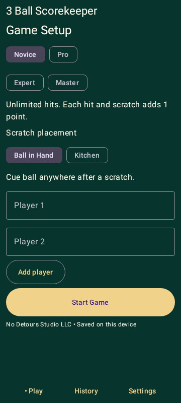 | 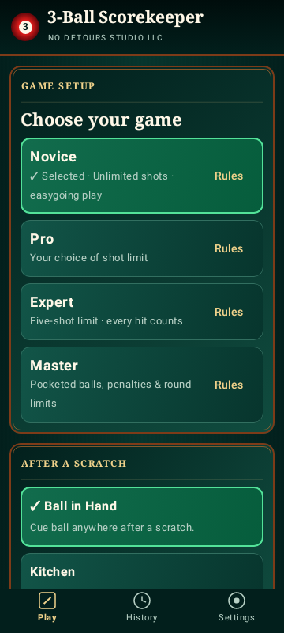 |
| Master idle | 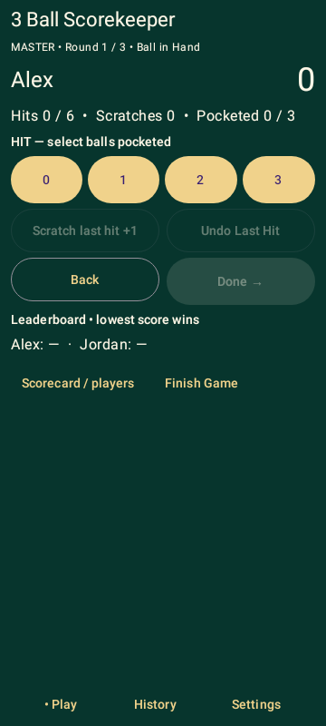 | 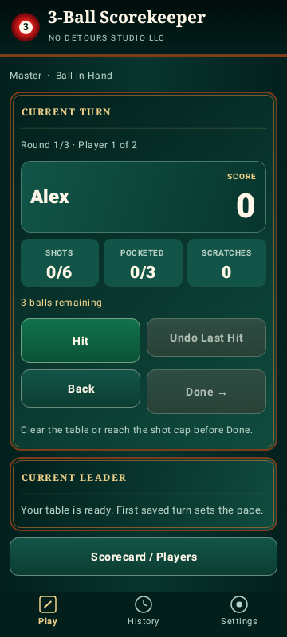 |
| Master after clearing on one hit | 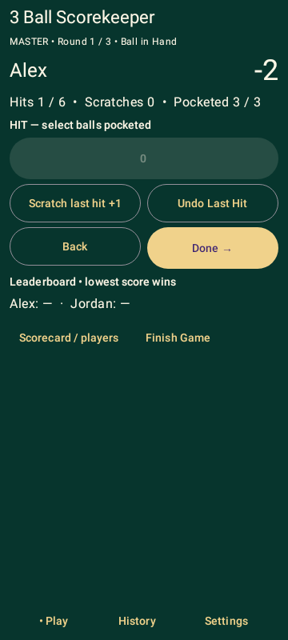 | 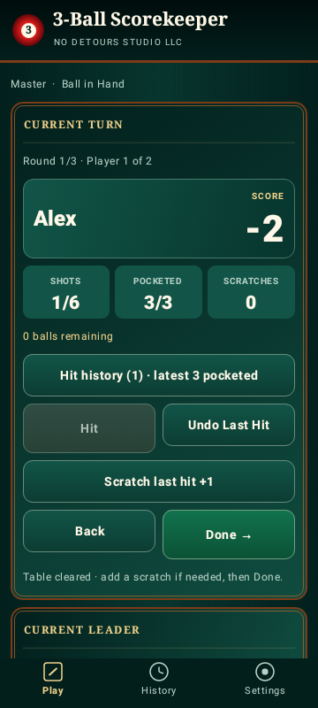 |

The baseline offered immediate numeric hit buttons. The redesigned idle state opens the chooser without recording a hit; only selecting a valid ball outcome records it.

## Secondary views

| Master hit chooser | Scorecard / Players | Completed history |
| --- | --- | --- |
| 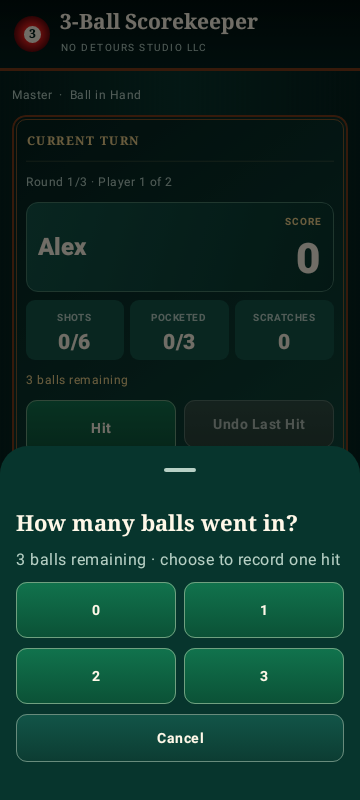 | 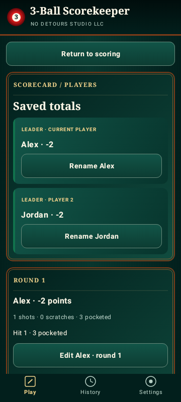 | 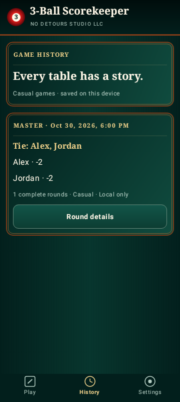 |

## Responsive review

Screens show the top of a scrolling viewport; content extending below the viewport can be reached by scrolling. Tests also scroll scoring actions into view to verify reachability. Large font layouts stack stat tiles instead of squeezing their labels.

| 360 × 640 dp | 400 × 900 dp | 200% font, 360 × 800 dp |
| --- | --- | --- |
| 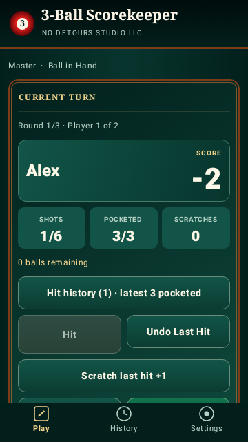 | 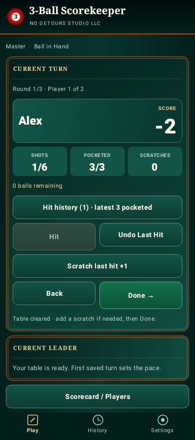 | 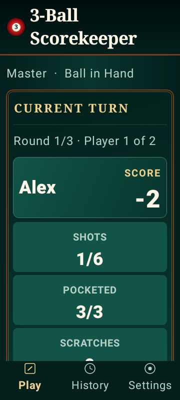 |

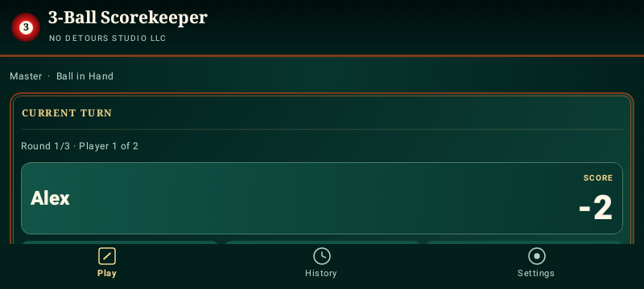

## Reproduce and review interactively

Open `app/src/main/java/com/nodetoursstudio/threeball/ui/ReviewPreviews.kt` in Android Studio. Ten named Compose previews cover setup, Master idle, chooser, negative score, scorecard, history, short/tall phones, landscape and 200% font.

`./gradlew :app:testDebugUnitTest --tests '*UiVisualReviewTest'` regenerates the after PNGs under `app/build/ui-review/`. Rendering uses an API 28 host runtime. Run all UI tests for interaction checks; a PNG alone does not prove gameplay correctness. Rendering is not a pixel-diff golden assertion and fonts may differ across hosts.

Before merge, the owner should review these images and walk through the app on an actual emulator/device: all four modes, undo/scratches, dirty Back/corrections, rename/withdraw, final review, finish/abandon, IME entry, system Back, history/settings and process restart. That device acceptance is still outstanding.
