# Phase 2.2 — premium UI polish review

**Review status: owner acceptance pending in Android Studio.** These are native-graphics **Robolectric host renders**, not Android emulator/device screenshots. They render the actual Compose components and local sample records. Android OS bars/IME, physical haptics, TalkBack, GPU shadow/font differences and device performance require a device walkthrough. Modal window dimming is approximated by the capture harness. These images are documentation, not app runtime artwork.

## Before / after at 360 × 800 dp

Before captures use the Phase 2.1 presentation at `f04873d7bded804f66e9ee610abb818583282265`. The two added Novice/Settings fixtures reuse those unchanged components; no baseline branch was modified. After captures use the final polish components. All sample record values are produced by the unchanged engine/record layer. Compare appearance, not authentication or competitive eligibility: every result is casual/local.

| State | Before — Phase 2.1 | After — Phase 2.2 |
| --- | --- | --- |
| Setup | 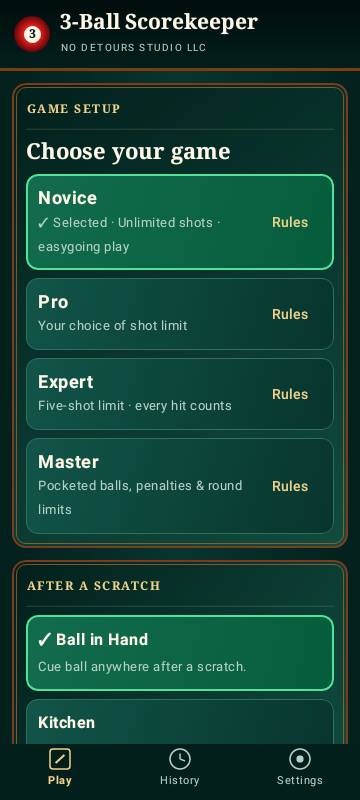 | 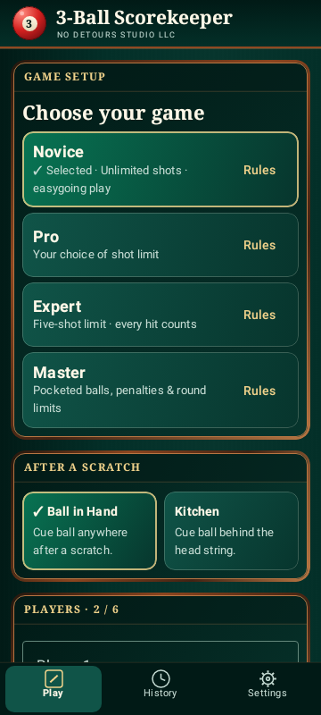 |
| Novice scoring | 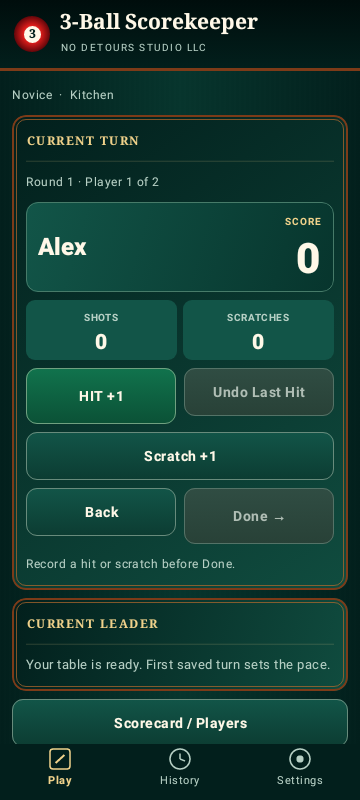 | 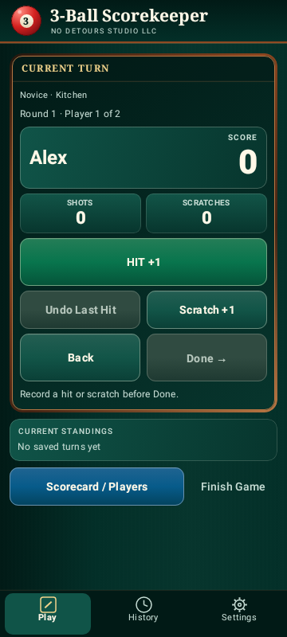 |
| Master idle | 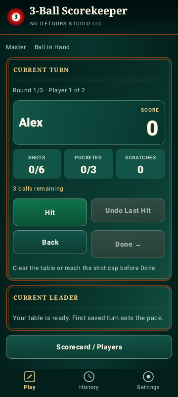 | 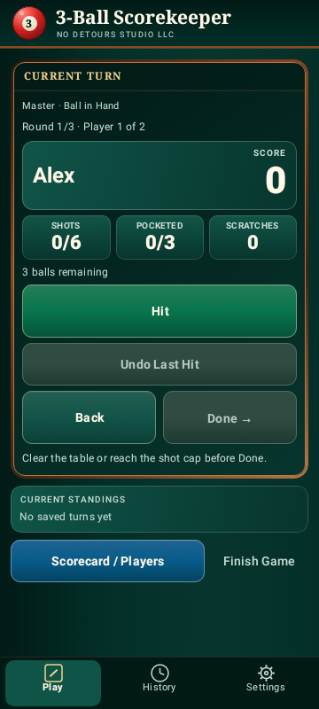 |
| Master chooser | 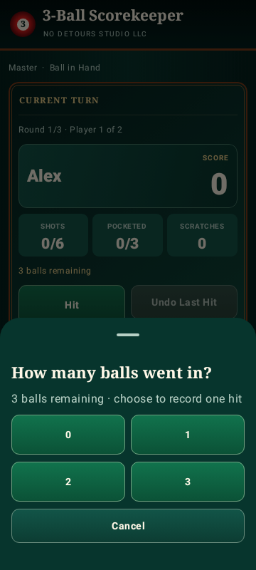 | 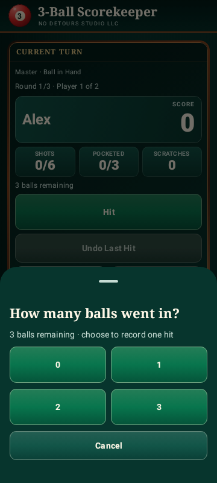 |
| Master cleared/negative | 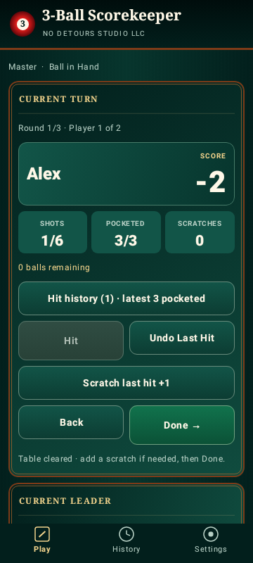 | 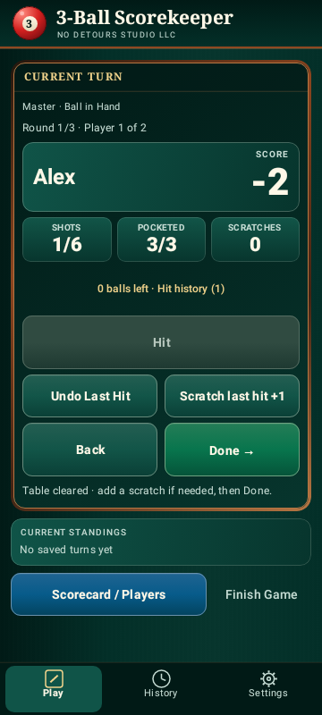 |
| Scorecard / players | 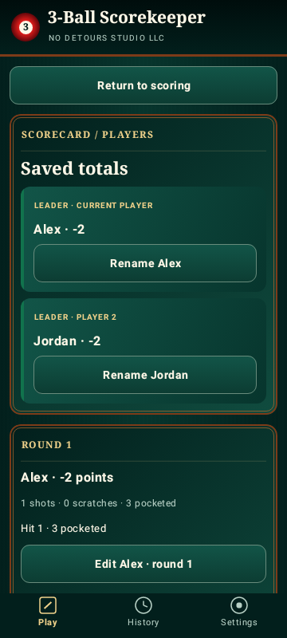 |  |
| Completed history | 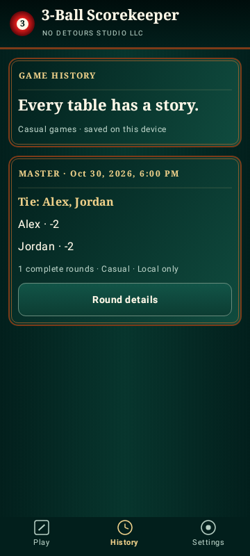 | 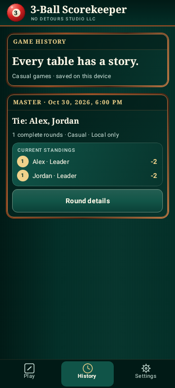 |
| Settings/navigation | 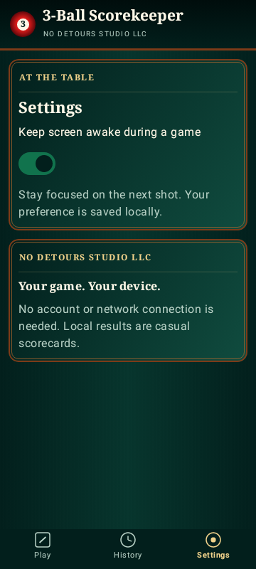 | 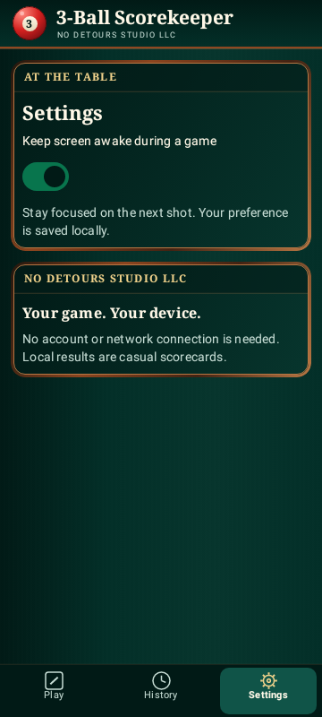 |

## Interaction and details

The held-Hit capture can be pixel-identical to the idle frame because this host capture path does not reliably repaint transient graphics/elevation layers. The pressed/released semantics, reduced-motion scale and single-click behavior are checked by `TactileButtonTest`; use an actual device to approve the animated appearance. A selected-round capture can also match its initial viewport when that round is already selected and visible.

| Held Hit button (pressed/elevation state) | Expanded six-player history |
| --- | --- |
|  | 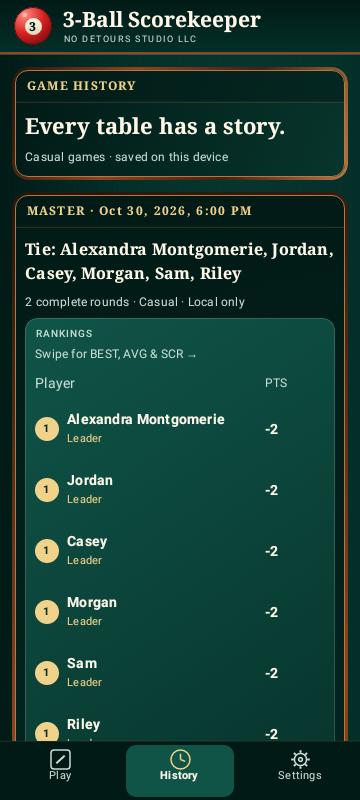 |

| Selected scorecard round | Selected history round |
| --- | --- |
| 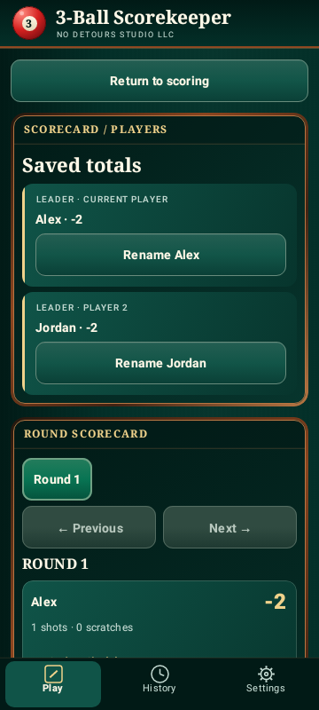 | 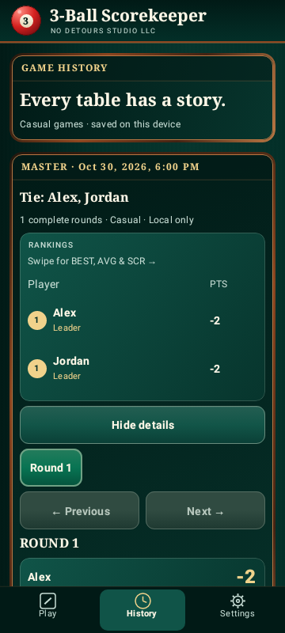 |

Rankings intentionally scroll horizontally for PTS/BEST/AVG/SCR instead of squeezing figures; the interface includes a swipe hint. Only one history game is expanded at a time. Medals represent local per-game ranks, including ties, never verified online achievements. Master hit details remain expandable.

## Responsive comparisons

| State | Before | After |
| --- | --- | --- |
| Short 360 × 640 | 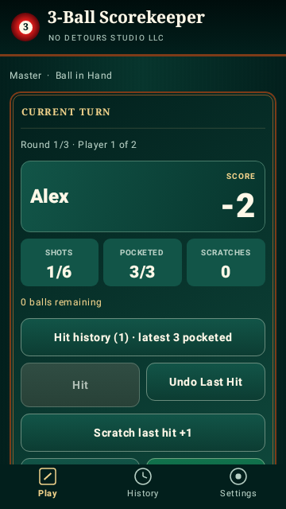 | 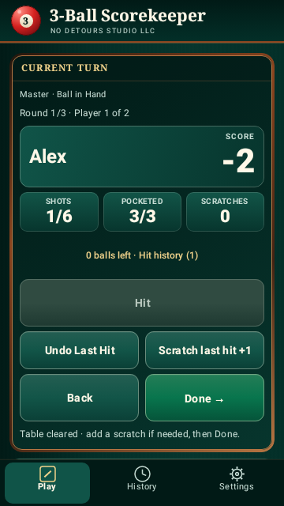 |
| Tall 400 × 900 | 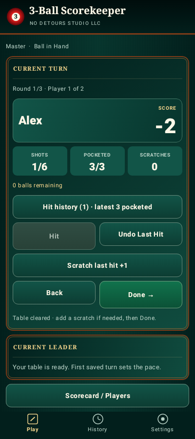 | 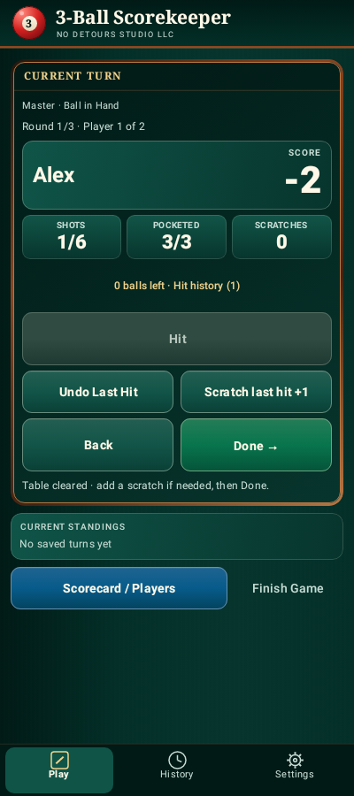 |
| 200% font | 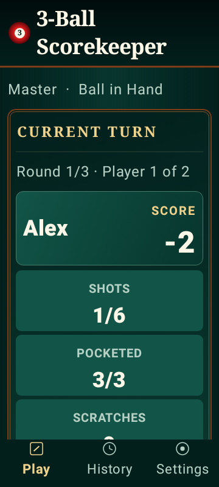 | 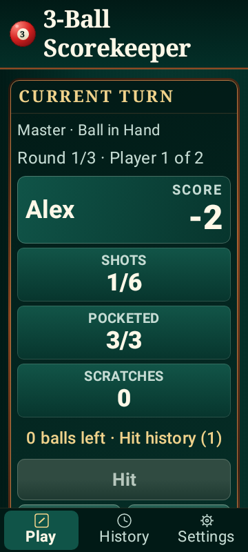 |
| Landscape 800 × 360 | 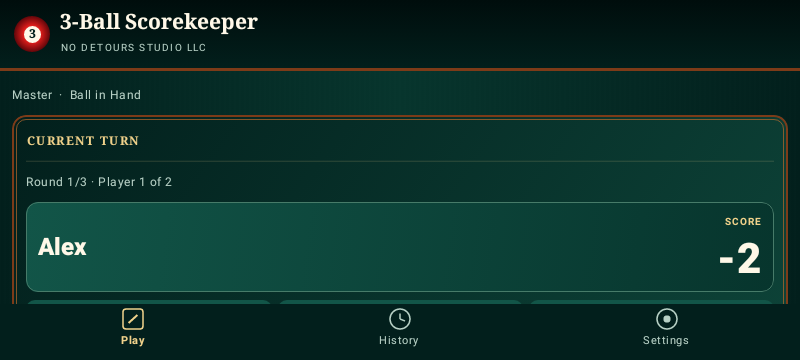 | 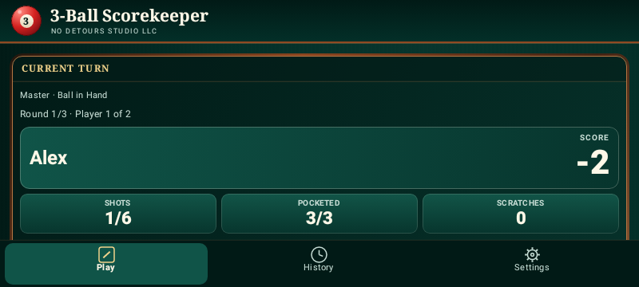 |

Additional checks: [130% font](after/master-font-130.png), [six players and a long active name at 420 × 900](after/six-players.png). Images show a viewport into naturally scrolling content. Reachability tests scroll controls into view; a partially visible card at the bottom of a screenshot is not a fixed-height clipped field.

## Reproduce

- Android Studio: open `ui/ReviewPreviews.kt` for 15 named Compose previews.
- `./gradlew :app:testDebugUnitTest --tests '*UiVisualReviewTest'` writes 18 after PNGs to the ignored `app/build/ui-review/` directory.
- All tests: `./gradlew :engine:test :records:test :app:testDebugUnitTest :app:assembleDebug :app:lintDebug`.
- The capture test composites actual Activity/dialog view roots using the API 28 native host renderer. It is a reproducible visual aid, not a pixel-diff golden assertion or substitute for emulator acceptance.

The twelve before images were frozen before changing the design system. The eighteen after images include the matching twelve plus expanded history, six-player/long-name layout, 130% font, pressed Hit and two focused round views. No network artwork or fonts are used.
